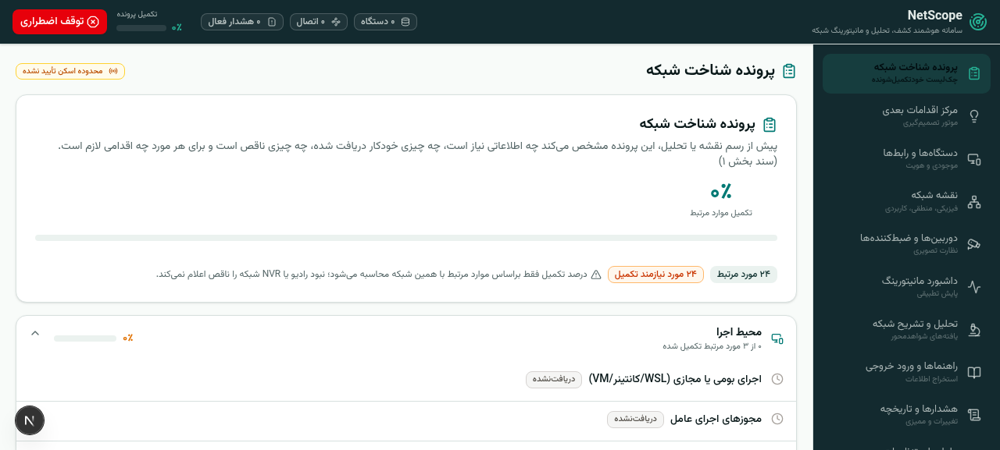
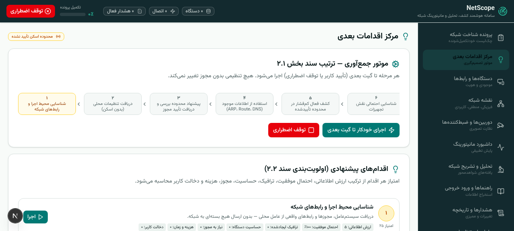
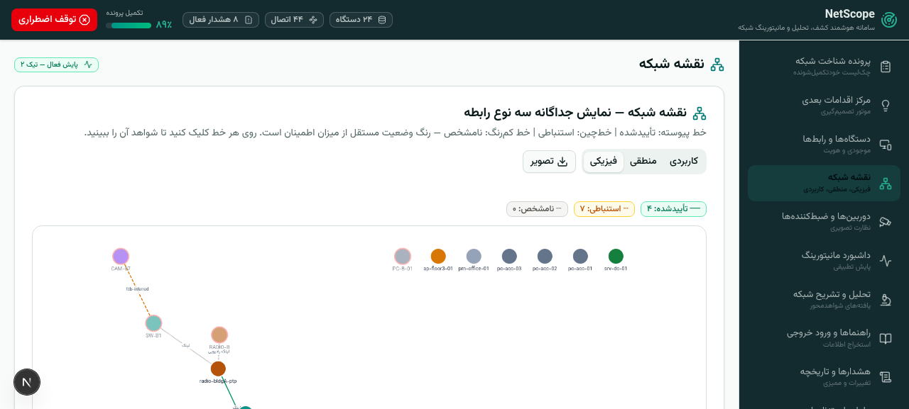
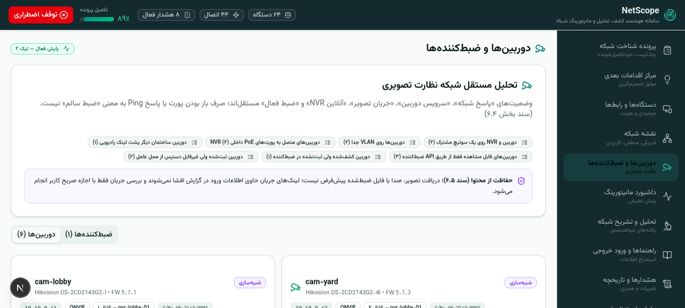

# NetScope — سامانه کشف، تحلیل و پایش هوشمند شبکه

NetScope یک سامانه کشف خودکار اطلاعات شبکه، تحلیل و پایش است که برای **شبکه‌های محلی مجاز** (سازمانی/آزمایشی) طراحی شده است. هدف اصلی: **حداکثر جمع‌آوری خودکار اطلاعات معتبر**، نمایش **صادقانه عدم قطعیت** به‌جای حدس زدن، و ارائه مسیر مشخص برای تکمیل اطلاعات ناقص.

> ⚠️ **ملاحظه اخلاقی و حقوقی:** این ابزار فقط باید روی شبکه‌هایی اجرا شود که مجوز صریح بررسی آن‌ها را دارید. کشف هر شبکه جدید به‌معنای کسب مجوز اسکن نیست.

---

## ✨ قابلیت‌ها

### ۱. پروفایل شناخت شبکه + چک‌لیست پویا
- چک‌لیست پویا با **۱۴ گروه اطلاعاتی** (هویت دستگاه، رابط‌ها، آدرس‌دهی، مسیریابی، DNS، VLAN، توپولوژی، PoE، دوربین، ضبط‌کننده و…)
- **۱۰ وضعیت** شفاف برای هر آیتم: جمع‌آوری‌نشده، در حال جمع‌آوری، جمع‌آوری‌شده، با اطمینان پایین، نیاز به دسترسی، نیاز به اقدام کاربر، تناقض، منقضی، خارج از محدوده، غیرقابل جمع‌آوری در حال حاضر
- **نرخ تکمیل واقع‌بینانه**: فقط آیتم‌های مرتبط با همان شبکه حساب می‌شوند (نبودِ لینک رادیویی یا NVR باعث «ناقص» شدن شبکه نمی‌شود)
- هر مقدار شامل: روش جمع‌آوری، زمان، سطح اطمینان، اعتبار (TTL)، الزامات دسترسی و راهنمای استخراج

### ۲. موتور جمع‌آوری مبتنی بر شواهد (Evidence-driven)
- هر نتیجه به **شواهد، منبع، زمان، سطح اطمینان و محدودیت‌های نتیجه** متصل است
- جدا کردن داده خام، داده نرمال‌شده و نتایج تحلیل
- ثبت تمامی تلاش‌های جمع‌آوری (موفق و ناموفق) به‌عنوان شواهد

### ۳. تجزیه خروجی دستورات
- پشتیبانی از خروجی JSON و متنی: `ip -j address/route/neigh show`، `resolvectl`، `Get-NetIPConfiguration`، `ipconfig /all` و…
- پیش‌نمایش تجزیه قبل از ثبت + تبدیل به رابط، آدرس‌ها، مسیرها و DNS با ذکر شواهد

### ۴. سه نقشه تفکیک‌شده (Cytoscape.js)
- **فیزیکی** (اتصال پورت)، **منطقی** (شبکه/VLAN/گیت‌وی)، **کارکردی** (وابستگی سرویس‌ها)
- خط توپُر = تأییدشده با شواهد، خط‌چین = استنباطی، کم‌رنگ = نامشخص
- قاعده طلایی: **«MAC دیده‌شده روی پورت سوئیچ ≠ اتصال مستقیم»** — اتصال فیزیکی فقط با FDB/LLDP و اطمینان کافی

### ۵. دوربین و ضبط‌کننده (CCTV) — فاز ۳
- **کشف ONVIF واقعی**: WS-Discovery (UDP مالتی‌کست ۲۳۹.۲۵۵.۲۵۵.۲۵۰:۳۷۰۲) + GetDeviceInformation با احراز هویت Digest — بدون هیچ دریافت محتوای تصویری
- **پلاگین‌های نسخه‌دار سازندگان**: Dahua HTTP API، Hikvision ISAPI و ONVIF عمومی — افزودن سازنده جدید بدون تغییر هسته، هر پلاگین نسخه مستقل دارد
- **مدل‌سازی کامل رابطه‌ها**: دوربین ↔ پورت سوئیچ (PoE) ↔ کانال ضبط‌کننده با سطح اطمینان مبتنی بر شواهد
- **ارتقای اطمینان با PoE**: MAC تک‌گانه روی پورت = استنباطی؛ همراه با توان PoE کشیده‌شده = تأییدشده
- **تفکیک ۵ وضعیت مستقل**: پاسخ شبکه ≠ سرویس ONVIF ≠ جریان تصویر ≠ آنلاین NVR ≠ ضبط فعال
- **ادغام خودکار هویت تکراری** (سند ۴.۲): دوربین کشف‌شده از ONVIF و ثبت‌شده از ARP عامل با MAC یکسان ادغام می‌شوند
- **ریشه‌یابی صادقانه**: «کانال آفلاین + خطای PoE داخلی» ≠ «کانال آفلاین + لینک رادیویی قطع» — علت محتمل از شواهد جدا می‌شود

### ۶. پایش تطبیقی و هشدار ضدلرزش
- دسترسی‌سنجی (ICMP/TCP) با فاصله تطبیقی
- هشدار فقط پس از **چند شکست متوالی** + آستانه بازیابی مستقل
- **تجمیع خرابی بالادست** (سوئیچ قطع ⇒ هشدار دوربین‌های پشت آن تجمیع می‌شود)

### ۷. تحلیل و توصیف مبتنی بر شواهد
- یافته‌های تحلیلی همراه با ارجاع به شواهد
- اصل: مدل هوش مصنوعی فقط **مفسر** داده ساختاریافته است، نه منبع واقعیت

### ۸. مرکز اقدام، راهنماها و حسابرسی
- اقدامات پیشنهادی مرتب‌شده بر اساس اثر
- راهنمای گام‌به‌گام جمع‌آوری برای هر نوع دستگاه (ویندوز/لینوکس/سوئیچ/دوربین)
- **گزارش حسابرسی کامل** از همه اقدامات سیستم

---

## 🛠 فناوری‌ها

| لایه | فناوری |
|---|---|
| فریم‌ورک | Next.js 16 (App Router) + TypeScript |
| UI | Tailwind CSS 4 + shadcn/ui + فونت وزیرمتن (RTL کامل) |
| نقشه شبکه | Cytoscape.js |
| دیتابیس | Prisma ORM (SQLite — قابل تعویض با PostgreSQL) |
| موتور قواعد | موتور داخلی TypeScript (چک‌لیست، شواهد، پایش، تحلیل) |

## 🚀 راه‌اندازی

```bash
# ۱) نصب وابستگی‌ها
bun install        # یا npm install

# ۲) تنظیم متغیرهای محیطی
cp .env.example .env

# ۳) ساخت دیتابیس
bun run db:push

# ۴) اجرا
bun run dev        # http://localhost:3000
```

در اولین اجرا، پروژه و چک‌لیست ۱۴ گروهی به‌صورت خودکار ساخته می‌شود. سپس از بخش «مرکز اقدام» می‌توانید گردش کشف را آغاز کنید یا خروجی دستورات واقعی خود را در «راهنماها» ثبت کنید.

## 📁 ساختار پروژه

```
src/
├── app/
│   ├── page.tsx                 # رابط تک‌صفحه‌ای با ۱۱ نمای اصلی
│   └── api/netscope/            # API: چک‌لیست، دستگاه‌ها، نقشه، پایش، تحلیل، ONVIF، NVR…
├── components/netscope/         # نماها: چک‌لیست، اقدامات، دستگاه‌ها، نقشه‌ها، CCTV، فاز ۲ و ۳…
└── lib/netscope/
    ├── engine.ts                # موتور اصلی: پروژه، شواهد، چک‌لیست، کشف
    ├── checklist-defs.ts        # تعریف ۱۴ گروه و آیتم‌های چک‌لیست
    ├── guides.ts                # راهنماهای استخراج (ویندوز/لینوکس/سوئیچ/دوربین)
    ├── parsers.ts               # تجزیه خروجی دستورات
    ├── monitor.ts               # پایش و هشدار ضدلرزش
    ├── analysis.ts              # یافته‌های تحلیلی مبتنی بر شواهد
    ├── snmp.ts                  # فاز ۲: جمع‌آوری SNMP فقط‌خواندنی
    ├── onvif.ts                 # فاز ۳: WS-Discovery + GetDeviceInformation (Digest)
    ├── nvr-plugins.ts           # فاز ۳: پلاگین‌های نسخه‌دار Dahua/Hikvision/ONVIF
    ├── cctv-apply.ts            # فاز ۳: اعمال نتایج، روابط PoE، ادغام هویت
    └── types.ts                 # مدل داده
prisma/schema.prisma             # مدل داده (۲۰+ موجودیت)
```

## 🖼 نمای برنامه

| | |
|---|---|
|  |  |
|  |  |

## 🗺 نقشه راه

- **فاز ۱ ✅** — چک‌لیست پویا، کشف پایه، ثبت شواهد، تجزیه خروجی دستورات، نقشه منطقی، پایش دسترسی
- **فاز ۲ ✅** — SNMPv3/v2c فقط‌خواندنی، FDB/LLDP/VLAN با تجزیه‌گر CLI (Cisco/MikroTik/Aruba/Huawei)، نقشه فیزیکی با درجات اطمینان، راهنمای سازندگان پلاگین‌محور و نسخه‌دار، سنجه‌ها با نمودار و گیت امنیتی محدوده
- **فاز ۳ ✅** — کشف ONVIF (WS-Discovery واقعی + GetDeviceInformation)، پلاگین‌های نسخه‌دار NVR/DVR (Dahua/Hikvision/ONVIF)، مدل دوربین-کانال-سوئیچ-PoE با ارتقای اطمینان، ادغام خودکار هویت تکراری، تفکیک ۵ وضعیت مستقل، ریشه‌یابی PoE
- **فاز ۴ 🔜** — عامل توزیع‌شده چندسایتی، تحلیل تغییرات، زمان‌بندی تطبیقی، گزارش دوره‌ای

## 🔐 نکات امنیتی

- اسکن فقط در **محدوده تأییدشده**؛ اعتبارنامه‌ها فقط از فرم امن و بدون نمایش مجدد
- اولویت با SNMPv3 و دسترسی فقط-خواندنی؛ **بدون حدس رمز یا استفاده از رمزهای پیش‌فرض**
- هیچ تغییری در پیکربندی دستگاه‌ها اعمال نمی‌شود؛ همه اقدامات قابل حسابرسی‌اند
